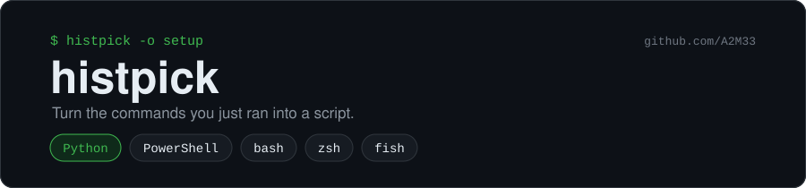
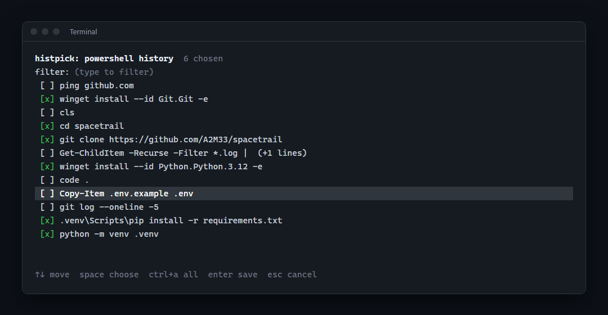

<p align="center"></p>

<p align="center">
  <a href="https://github.com/A2M33/histpick/actions/workflows/test.yml"></a>
  
  
  <a href="https://github.com/A2M33/histpick/blob/main/LICENSE"></a>
</p>

You spent twenty minutes getting something to work in the terminal: installing a tool, cloning a repo, setting up a virtual environment. Next month you'll need the same steps on another machine. histpick shows your recent commands, you tick the ones that mattered, and it writes them to a script you can run again.



It reads PowerShell, bash, zsh and fish history. PowerShell gets a `.ps1`, the others get a script with the right shebang.

## Install

**Windows, no Python needed.** Download `histpick.exe` from the [latest release](https://github.com/A2M33/histpick/releases/latest). Windows SmartScreen may warn you the first time because the file isn't code-signed; click "More info", then "Run anyway". GitHub Actions builds the file from this repository on every release.

**With Python 3.10 or newer** (Windows, Linux, macOS):

```bash
pip install git+https://github.com/A2M33/histpick
```

## Use

```bash
histpick              # pick commands, save as histpick-<date>.ps1 (or .sh)
histpick -o setup     # save as setup.ps1 / setup.sh
```

After saving, histpick prints the full path and the command that runs the script. On Windows that command is `powershell -ExecutionPolicy Bypass -File "<path>"`, since Windows refuses to run unsigned `.ps1` files by default.

| Key | Action |
| --- | --- |
| `↑` `↓`, `PgUp` `PgDn` | Move |
| `Tab` | Choose or unchoose a command |
| Typing | Filter the list. `git push` shows commands that contain both words, in any order |
| `←` `→`, `Backspace`, `Delete` | Edit the filter |
| `Ctrl+U` | Clear the filter |
| `Ctrl+A` | Choose everything that matches the filter |
| `Ctrl+O` | Show only the chosen commands; press again to show all |
| `Enter` | Review the chosen commands (with nothing chosen, it takes the highlighted one) |
| `Esc` | Clear the filter; press it again to cancel |

The list shows the newest command first and each command once. The top line counts the matches, like `12/300`. When you highlight a multi-line command, a pane under the list shows all of its lines.

If you ran a command twice, histpick places it where you ran it last, so the review screen shows the commands in the order they will run before you save:

| Key | Action |
| --- | --- |
| `↑` `↓` | Select a command |
| `Ctrl+↑` `Ctrl+↓`, or `U` `D` | Move it up or down in the script |
| `X` or `Backspace` | Remove it |
| `Enter` | Save |
| `Esc` | Go back to the list |

### Without the picker

```bash
histpick --list                 # numbered list, 1 = newest
histpick --pick "7-5 2" -o fix  # save commands 7, 6, 5 and 2, in that order
histpick --last 4 --print       # print the last 4 commands as a script
histpick --grep docker          # only offer commands containing "docker"
```

`--pick` writes the commands in the order you list the numbers. `--last` keeps the order you ran them in.

Other options: `--shell bash` to read another shell's history, `--limit 500` to offer more commands (default 300), `--force` to overwrite a file.

## What the script looks like

```powershell
# Saved with histpick from PowerShell history on 2026-10-29 13:10
$ErrorActionPreference = 'Stop'
$PSNativeCommandUseErrorActionPreference = $true
$global:LASTEXITCODE = 0

winget install --id Git.Git -e
if ($LASTEXITCODE) { exit $LASTEXITCODE }

git clone https://github.com/A2M33/spacetrail
if ($LASTEXITCODE) { exit $LASTEXITCODE }
```

The script stops at the first error, the way you would stop if you were typing. `$ErrorActionPreference` stops it when a PowerShell cmdlet fails. Windows PowerShell 5.1 ignores the exit code of programs like `git` and `winget`, so histpick adds the `$LASTEXITCODE` check after each command. bash and zsh scripts get `set -euo pipefail`. fish has no such switch, so each command in a fish script gets `or exit $status` after it.

Read the script before you run it: your history may contain one-off commands, passwords typed in clear text or paths that only exist on your machine. histpick puts a `!` next to commands that mention a password, token, secret or API key, or that hold an AWS or GitHub key, both in the picker and in `--list`, and warns you before it saves one. It matches words and key formats, so it can miss a secret, and it will flag `npm token list` too.

## Where history comes from

| Shell | File | Note |
| --- | --- | --- |
| PowerShell | `%APPDATA%\Microsoft\Windows\PowerShell\PSReadLine\ConsoleHost_history.txt` | Saved after every command |
| bash | `~/.bash_history` (or `$HISTFILE`) | bash writes it when the shell exits; run `history -a` first to include the current session |
| zsh | `~/.zsh_history` | Plain and extended formats |
| fish | `~/.local/share/fish/fish_history` | |

Without `--shell`, histpick uses the shell it was started from, or the history file that changed last. Multi-line commands stay intact, and histpick leaves its own calls out of the list.

## Development

```bash
git clone https://github.com/A2M33/histpick
cd histpick
pip install -e ".[dev]"
pytest
```

The picker logic lives in `PickerState` (`src/histpick/picker.py`) with no terminal code, so the tests drive it directly. GitHub Actions runs them on Windows, Linux and macOS.

## License

MIT
